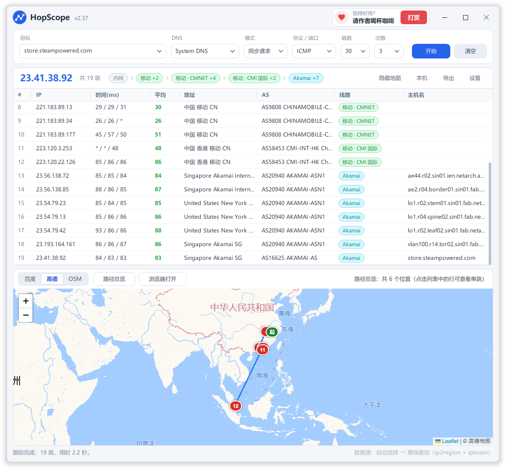

# HopScope

**看清数据包走过的每一步。**

一款为 Windows 打造的现代路由追踪工具：逐跳延迟、地理位置、运营商线路、地图路径，一屏尽览。
BestTrace / Opentrace 完美替代。

[**⬇ 下载最新版**](https://github.com/Pockoo/HopScope/releases/latest) · [反馈建议](https://github.com/Pockoo/HopScope/issues) · [更新日志](https://github.com/Pockoo/HopScope/releases)

---

## 为什么是 HopScope？

打开一个网站很慢，游戏延迟忽高忽低，买的 VPS 号称 CN2 却总觉得不对劲——问题到底出在哪一段？

传统的 `tracert` 只给你一串冷冰冰的 IP 和星号。**HopScope 把它们变成一张看得懂的路线图**：每一跳在哪座城市、属于哪家运营商、走的是什么线路、延迟在哪里突然飙升，一目了然。

> 不只是追踪路由，而是读懂路由。

---

## ✨ 亮点

### 🚀 快，而且轻
- **同步请求模式**：所有跳点并行探测，一次完整追踪通常只需几秒。
- 原生 C++ 编写，事件驱动、零轮询，运行时 CPU 占用几乎可以忽略。
- 单个 exe，**免安装、不写注册表**，配置随程序放置，U 盘带着走。

### 🗺️ 路径，画在地图上
- 点击任意一跳，下方地图即刻定位。
- 追踪完成后自动生成 **路径总览**：从你的公网出口到目标，一条线串起途经的每一座城市。
- 高德 / 百度 / OpenStreetMap 底图随心切换，也可一键在浏览器中打开。

### 🧭 一眼认出线路
自动识别运营商与骨干网，并以彩色胶囊标注：

| 运营商 | 可识别线路 |
|---|---|
| 中国电信 | 163 骨干 · **CN2** · CTG 国际 |
| 中国联通 | 169 骨干 · **9929 A 网** · CUG 国际 |
| 中国移动 | CMNET · **CMI** · CMHK |
| 其它 | 教育网、科技网、阿里云、腾讯云、Cloudflare、AWS、NTT、Cogent 等主流云厂商与国际骨干，以及 AMS-IX、DE-CIX 等互联网交换中心 |

标题栏的 **线路条** 会把整条路径压缩成一句话，例如：
`电信 · 163骨干 ×4 → 电信 · CN2 ×3 → NTT ×2 → Cloudflare`

### 🔍 替你发现问题
- **延迟跃升标记**：自动找出整条路径中延迟涨幅最大的一跳，跨境链路、拥塞节点无处遁形。
- **延迟分档着色**：绿 / 黄 / 红，好坏一眼可辨。
- **多路径提示**：同一跳出现多个应答地址（负载均衡）时会有提示，悬停即可查看全部地址。
- **是禁 Ping 还是真的不通？** 未到达目标时，程序会自动测试 TCP 443 / 80，给出明确结论。
- 本机断网、无路由、包超过 MTU 等情况都会说清原因，不再是满屏的 `*`。

### 🛡️ 穿透 ICMP 屏蔽
部分网络会屏蔽 ICMP。切换为 **TCP SYN 追踪**（80 / 443 或自定义端口）就能穿过去。IPv4 与 IPv6 均完整支持。

### 📸 一键导出，好看到想分享
- 导出为 **精美长图**：目标信息、统计卡片、线路条、路径示意图与完整结果表，排版一气呵成。
- 右键「导出」即可直接 **复制图片到剪贴板**，粘进聊天窗口就能发。
- 也可导出 TXT / CSV，方便存档与分析。
- **隐私打码**：可隐藏最近几跳（家庭网关、本地运营商节点），放心分享。

### 🌐 DNS 自由选
支持系统 DNS、自定义 DNS（含非标准端口）以及 **DoH 加密 DNS**，在 `DNS.txt` 中每行写一个即可。

### 🎨 用起来舒服
- 简洁现代的自绘界面，圆角、柔和阴影、ClearType 清晰文字，完美兼容 MacType。
- 高 DPI 自适应，4K 屏同样锐利。
- 「本机」面板：网卡、网关、DNS、IPv4 / IPv6 公网出口，一处看全。

---

## 📦 下载与使用

1. 前往 [**Releases**](https://github.com/Pockoo/HopScope/releases/latest) / [**百度网盘**](https://pan.baidu.com/s/1zvSp7OjpqNnpGsiV-AlPVA?pwd=6666) / [**蓝奏网盘**](https://justapp.lanzoub.com/b0kph7o7g?pwd=gp07) 下载最新版压缩包，解压到任意文件夹。
2. 双击 `HopScope.exe`。
3. 输入域名或 IP（直接粘贴网址也行），按 **回车** 或点击 **开始**。

就这么简单。

> **小提示**
> - TCP 追踪需要管理员权限，程序会提示，并可一键以管理员身份重启。
> - 运行中按 `Esc` 随时停止。
> - 右键结果行可以复制 IP、复制整行，或把该跳设为新的追踪目标。

### 系统要求
- Windows 10 / 11（64 位或 32 位）
- 内嵌地图优先使用系统自带的 WebView2，没有时自动改用 IE 内核，无需额外安装

---

## 📚 离线数据库（可选）

默认使用在线接口查询地区与 ASN。若希望 **完全离线、查询更快**，可将以下文件放到程序同目录，程序会自动识别：

| 文件 | 用途 | 来源 |
|---|---|---|
| `ip2region_v4.xdb` / `ip2region_v6.xdb` | IP 地区 | [ip2region](https://github.com/lionsoul2014/ip2region) |
| `ip2asn-combined.tsv` 或 `.tsv.gz` | ASN 与运营商 | [iptoasn](https://iptoasn.com/) |

在「设置 → 地区数据源」中可选择 自动 / 在线 / 仅离线。

---

## 📖 结果怎么看

| 符号 | 含义 |
|---|---|
| `23` | 收到回应，延迟 23 毫秒 |
| `*` | 无应答：超时，或被对方静默丢弃 |
| `…` | 探测进行中 |
| `!N` `!H` | 路由器返回：网络不可达 / 主机不可达 |
| `!X` | 路由器返回：被管理策略拒绝 |
| `+2` | 这一跳还有 2 个其它应答地址（多路径） |
| 🔺 | 整条路径中延迟上升最明显的一跳 |

> 路由器的地理位置本身并不精确，线路识别基于 AS 号与 IP 段推断（例如无法区分 CN2 GIA 与 GT），仅供参考。

---

## 🔒 隐私说明

- 所有配置保存在程序目录（`settings.ini`、`history.txt`），不写注册表。
- 地区查询仅发送各跳的公网 IP，内网地址在本地判断，不会联网。

---

## 💬 反馈与支持

- 遇到问题或有好点子？欢迎在 [**Issues**](https://github.com/Pockoo/HopScope/issues) 留言，每一条我都会认真看。
- 觉得好用，**点一个 ⭐ Star** 就是最好的鼓励。
- 也可以在程序右上角「请作者喝杯咖啡」☕，你的支持是持续更新的动力。
- 
---

由 [Pockoo](https://github.com/Pockoo) 用心打造 · Copyright © 2026

